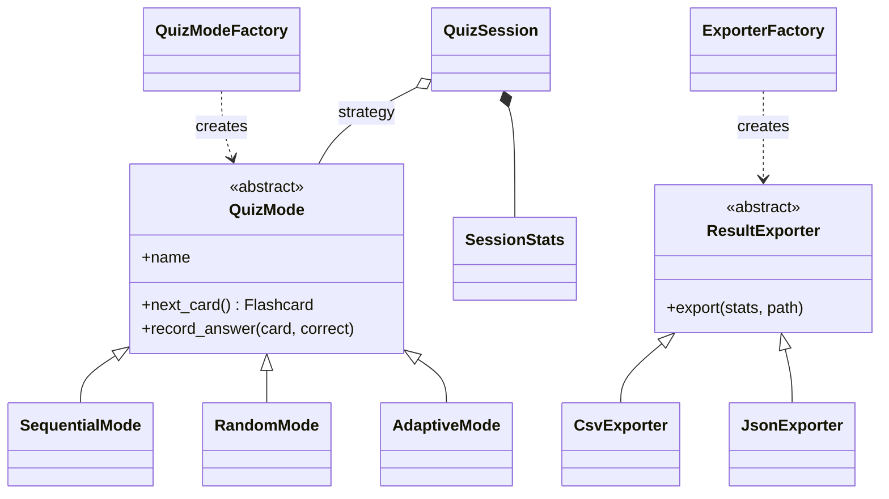
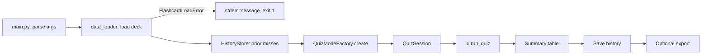

# Flashcard Quizzer

A command-line flashcard app for memorising terms, such as the server acronyms a new hire has to learn. It loads a deck from a JSON file, quizzes you in **sequential**, **random** or **adaptive** order, gives immediate green/red feedback, and ends with a summary table. Results are kept between runs, so `--stats` shows your weakest cards and adaptive mode asks them first.

The app uses only the Python standard library. It was built with an AI coding assistant (Claude Code) as part of an AI-assisted development course; see [docs/ai_edit_log.md](docs/ai_edit_log.md) and [docs/report.md](docs/report.md).

## Features

- **Two deck formats**: a plain list of cards, or an object with a `"cards"` list.
- **Strict validation with friendly errors**: a missing file, bad JSON, a card without a `back` and similar problems produce one readable line and exit code 1, never a traceback.
- **Three quiz modes**, built with the Strategy pattern and picked by a Factory:
  - `sequential`: cards 1 to N in file order
  - `random`: shuffled (use `--seed` to repeat an order)
  - `adaptive`: cards you missed in earlier sessions come first, and a card you get wrong comes back two questions later (at most twice)
- **Forgiving answer matching**: case, surrounding spaces and repeated spaces are ignored.
- **Session summary**: total questions, correct, incorrect, accuracy %, and a table of missed terms with their answers.
- **Lifetime history and `--stats`**: per-card attempts and accuracy across all sessions, worst first.
- **Export** a session to CSV or JSON (`--export results.csv`). CSV cells are protected against spreadsheet formula injection.
- **Question limit** (`--limit N`).
- **Graceful exit**: type `exit` or `quit`, press Ctrl+D or press Ctrl+C at any question to stop and still see your summary.
- **Colour that steps aside**: colours appear only on a real terminal and are off with `--no-color` or the `NO_COLOR` environment variable. Feedback is always written out too, so colour is never the only signal.

## Requirements

- Python 3.9 or newer (developed and tested on 3.9.6)
- No runtime dependencies. `requirements.txt` lists the development tools: pytest, pytest-cov, black, isort, flake8, mypy and bandit.

## Setup

**In the course workspace**, install the tools directly:

```bash
cd /voc/work/project/starter
python -m pip install -r requirements.txt
```

**On your own computer**, use a virtual environment (on macOS this also gives you a `python` command):

```bash
python3 -m venv venv
source venv/bin/activate        # Windows: venv\Scripts\activate
python -m pip install -r requirements.txt
```

## Usage

```bash
python main.py --help
python main.py --mode sequential --file data/glossary.json
python main.py -m adaptive -f data/python_basics.json
python main.py -m random -f data/glossary.json --limit 5 --seed 42
python main.py -f data/git_commands.json --export results.csv
python main.py -f data/glossary.json --stats
```

| Flag | Meaning |
| --- | --- |
| `-f`, `--file DECK` | JSON deck to load (required) |
| `-m`, `--mode {sequential,random,adaptive}` | Question order (default `sequential`, case-insensitive) |
| `--stats` | Show lifetime results for the deck and exit without quizzing |
| `-n`, `--limit N` | Ask at most N distinct cards |
| `-e`, `--export PATH` | Save the session's answers to a `.csv` or `.json` file |
| `--history-file PATH` | Where lifetime results are kept (default `~/.flashcard_quizzer/history.json`) |
| `--seed N` | Seed for random mode |
| `--no-color` | Plain output without ANSI colours |

### Example session

```text
$ python main.py -m adaptive -f data/glossary.json
Flashcard Quizzer
Deck: glossary.json (10 cards) | Mode: adaptive
Type your answer and press Enter. Type 'exit' or press Ctrl+C to stop.

Question 1: API
Your answer: application programming interface
Correct!

Question 2: CDN
Your answer: content network
Incorrect. The answer is: Content Delivery Network

Question 3: CPU
Your answer: Central Processing Unit
Correct!

Question 4: DNS
Your answer: exit

Session Summary (stopped early)
+-----------------+-------+
| Metric          | Value |
+-----------------+-------+
| Total Questions |     3 |
| Correct         |     2 |
| Incorrect       |     1 |
| Accuracy        | 66.7% |
+-----------------+-------+
Missed terms:
+------+--------------------------+
| Term | Correct answer           |
+------+--------------------------+
| CDN  | Content Delivery Network |
+------+--------------------------+
```

A broken deck produces one line on stderr and exit code 1:

```text
$ python main.py -f bad.json
Error: Invalid deck bad.json: card 1: "back" must be text, got a number
```

### Exit codes

| Code | When |
| --- | --- |
| 0 | Quiz finished or stopped by the user; `--stats` shown |
| 1 | The deck could not be loaded, or the export failed |
| 2 | Invalid command-line arguments (for example an unknown mode or `--limit 0`) |

## Deck format

Either of these works:

```json
[
  {"front": "API", "back": "Application Programming Interface"},
  {"front": "DNS", "back": "Domain Name System"}
]
```

```json
{
  "cards": [
    {"front": "Which keyword defines a function?", "back": "def"}
  ]
}
```

Rules: the deck must have at least one card; every card needs non-empty text `front` and `back` (other fields are ignored); text may not contain control characters such as tabs, line breaks or terminal escape codes; files over 5 MB are refused. Sample decks are in `data/`: `glossary.json` (array), `python_basics.json` and `git_commands.json` (object).

## Architecture

| Module | Responsibility |
| --- | --- |
| `main.py` | Command-line parsing, wiring, exit codes |
| `models.py` | `Flashcard` and `AnswerResult` data classes |
| `data_loader.py` | Load and validate decks; `FlashcardLoadError` |
| `quiz_engine.py` | `QuizMode` strategies, `QuizModeFactory`, `QuizSession`, answer matching |
| `stats.py` | `SessionStats`: totals, accuracy, missed terms |
| `history.py` | `HistoryStore`: lifetime per-card results, used by `--stats` and adaptive mode |
| `exporters.py` | `ResultExporter` classes and `ExporterFactory` (CSV/JSON) |
| `ui.py` | `ConsoleUI` (all printing and input) and the `run_quiz` loop |
| `utils/file_handler.py` | Safe JSON reading (size limit, friendly errors) and atomic JSON writing |
| `utils/colors.py`, `utils/table.py` | ANSI colours with auto-detection; boxed text tables |

The engine does no input or output, and the UI does no grading, so each layer can be tested on its own. Input and output streams are injected into `main()` and `ConsoleUI`, which lets the integration tests play a whole quiz with scripted answers.





### Design patterns

- **Strategy** (`quiz_engine.py`): sequential, random and adaptive are different algorithms for one task, choosing the next card. `QuizSession` works with any `QuizMode`, so the quiz loop never branches on the mode.
- **Factory** (`QuizModeFactory`): turns the `--mode` string into a strategy object. A new mode, such as spaced repetition, is one subclass decorated with `@QuizModeFactory.register`; the CLI picks it up automatically because its `--mode` choices come from the factory.
- **Factory** (`ExporterFactory`): picks the exporter from the file extension, so adding a format never touches `main.py`.

## Lifetime history

After each quiz with at least one answer, results are added to `~/.flashcard_quizzer/history.json` (change it with `--history-file`). Decks are identified by their full path and cards by their front. The file is written atomically. If it is unreadable or malformed, the app warns, keeps the old file as `history.json.bak` and starts a fresh history. A broken history file never stops a quiz.

## Testing and code quality

```bash
python -m pytest tests/                               # 173 tests
python -m pytest --cov=. --cov-report=html            # coverage report in htmlcov/
python -m black --check .
python -m isort --check-only .
python -m flake8 .
python -m mypy .                                      # every function must be typed
python -m bandit -r . -x ./venv,./tests               # security lint
```

Current results: all 173 tests pass, coverage of application code is **100%** (line and branch; `tests/` and `venv/` are excluded and the run fails below 80%), and black, isort, flake8, mypy and bandit report no issues. A text copy of the coverage report is in [docs/coverage_report.txt](docs/coverage_report.txt).

| Test file | Covers |
| --- | --- |
| `tests/test_flashcard_loader.py` | Both formats, shipped decks, every validation error |
| `tests/test_quiz_modes.py` | Factory, each strategy, adaptive repeats and priority, answer matching, session |
| `tests/test_integration.py` | Full sessions through `main()`: stats, exit/Ctrl+C/EOF, bad input, history, export, colour |
| `tests/test_history.py`, `test_exporters.py`, `test_stats.py`, `test_file_handler.py`, `test_utils.py` | Unit tests for the supporting modules |
| `tests/test_docstrings.py` | Runs the examples in docstrings so they stay correct |

## Project layout

```
main.py  models.py  data_loader.py  quiz_engine.py  stats.py
history.py  exporters.py  ui.py
utils/        file_handler.py, colors.py, table.py
data/         glossary.json, python_basics.json, git_commands.json
tests/        pytest suite and fixtures/
docs/         ai_edit_log.md, report.md, report_template.md, coverage_report.txt, design_patterns.md
ai_guidance/  prompting and code review guides
```

## Known limitations

- Typing `exit` or `quit` ends the quiz, except on a card whose correct answer is that word.
- History is keyed by card front, so two cards with the same front share one history record.
- Very old Windows consoles may print ANSI codes literally; use `--no-color` there.
